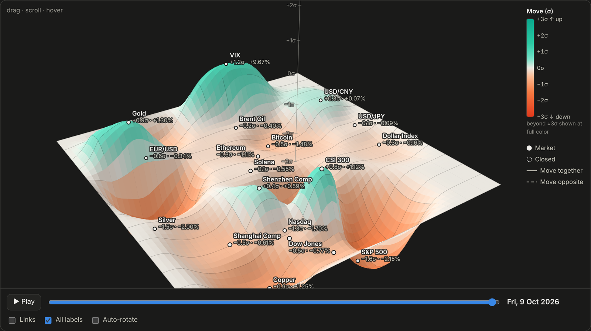
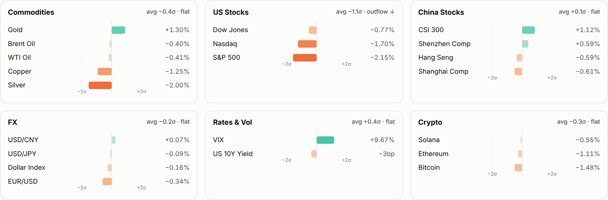

<div align="center">

# Market Pulse

**See how global markets moved today and where the money went, as one interactive 3D landscape.**

**English** · [中文](README.zh-CN.md)

[](https://github.com/HuangCixin/market-pulse/actions/workflows/ci.yml)
[](LICENSE)


[**▶ Live page**](https://HuangCixin.github.io/market-pulse/) (real data, updated every weekday) · [Demo](https://HuangCixin.github.io/market-pulse/demo.html) (synthetic data)



</div>

Market Pulse downloads daily prices for **21 markets** across commodities, US and Chinese stocks,
currencies, rates, volatility and crypto. It turns them into a single self-contained web page that
shows, at a glance:

- **What moved, and how unusual it was.** Every move is measured in σ (standard deviations of that
  market's normal daily move), so a 0.3% currency move and a 4% Bitcoin move are directly comparable.
- **Where the money went.** Markets are grouped into colored zones by asset class (metals, FX, China, energy, US, crypto),
  so a whole region rising or sinking shows money rotating between asset classes.
- **How markets are connected.** Correlations, relationships that recently changed, and next-day
  spillover from Wall Street to Shanghai and Hong Kong.

The page works offline, has no external dependencies, and switches between **English and 中文** with one click.

## Markets covered

| Group | Markets |
|---|---|
| Commodities | Gold, Silver, WTI Oil, Brent Oil, Copper |
| US Stocks | S&P 500, Nasdaq, Dow Jones |
| China Stocks | Shanghai Composite, CSI 300, Shenzhen Component, Hang Seng |
| FX | Dollar Index, EUR/USD, USD/CNY, USD/JPY |
| Rates & Vol | US 10-Year Yield, VIX |
| Crypto | Bitcoin, Ethereum, Solana |

Add or remove any market in [`config.yaml`](config.yaml). Any Yahoo Finance ticker works.

## What's on the page

| Section | What it shows |
|---|---|
| **Market terrain** | A 3D surface where height and color are each market's move in σ (teal = up, orange/red = down), with a color bar. Drag to rotate, scroll to zoom, hover for details, press **Play** to replay the last two months. |
| **Where the money moved** | One card per group with diverging bars, sorted from strongest to weakest. |
| **Trends** | Line charts per group over 1M / 3M / 6M / 1Y. |
| **How markets move together** | Relationships that changed (60-day vs 250-day correlation), US → China next-day table, rolling correlations for key pairs, and the full correlation grid. |
| **All markets** | Last price and 1D / 1W / 1M / 3M / YTD / 1Y changes. |

Controls at the top: **Period** (day / week / month), **Colors** (green = up, or the Chinese convention
red = up 红涨), **Theme** (light / dark), and **Language** (English / 中文).

<p align="center">
  
</p>

## Quick start

Requires Python 3.10+.

```bash
git clone https://github.com/HuangCixin/market-pulse.git
cd market-pulse
python -m venv .venv
source .venv/bin/activate          # Windows: .venv\Scripts\activate
pip install -r requirements.txt

python run_daily.py --demo --open  # try it with synthetic data (no internet needed)
python run_daily.py --open         # real data: download today's prices and open the page
```

| Command | What it does |
|---|---|
| `python run_daily.py` | Download prices and build today's page |
| `python run_daily.py --open` | Same, then open it in your browser |
| `python run_daily.py --demo` | Use synthetic data, useful for testing or offline |
| `python run_daily.py --cache` | Rebuild from the last download without fetching again |

Each run writes to `reports/<date>/`:

```
report.html       the interactive page (single file, share or open anywhere)
summary.json      headlines (EN + 中文), regime, σ moves, performance, correlation shifts
performance.csv   the performance table
```

**When to run it:** after the US market closes (22:00 in Paris, 04:00 in Beijing). At that point every
market group has a complete day.

### Run it every day automatically

**On GitHub (already set up):** the [`Daily update`](.github/workflows/pages.yml) workflow rebuilds the page
with real data every weekday at 22:30 UTC (00:30 Paris, 06:30 Beijing) and publishes it to GitHub Pages.
If a download fails, the previous day's page stays online. You can also start it by hand under
**Actions → Daily update → Run workflow**. GitHub pauses scheduled workflows in public repositories after
60 days without any commits; one click on **Enable workflow** in the Actions tab turns it back on.

**On your own computer:**

macOS / Linux (`crontab -e`, weekdays at 23:00):

```cron
0 23 * * 1-5 cd /path/to/market-pulse && .venv/bin/python run_daily.py >> logs.txt 2>&1
```

Windows: in Task Scheduler, create a daily task that runs `.venv\Scripts\python.exe run_daily.py` in this folder.

### Use it with Claude Code

The repo includes a [`CLAUDE.md`](CLAUDE.md) describing the project and its methodology rules. Open the
folder in [Claude Code](https://claude.com/claude-code) and ask *"Run today's report and explain what
happened"*, or ask it to add a market or a new chart.

## How it works

```
config.yaml ──► fetch.py ──► analyze.py ──► report.py ──► reports/<date>/report.html
 (markets)     (yfinance,    (moves, σ,      (headlines,    (template.html + data,
               CSV cache)    correlations,   JSON, CSV)      no dependencies)
                             3D layout)
```

The key ideas, in short (full detail in [docs/METHODOLOGY.md](docs/METHODOLOGY.md)):

- **σ, not %.** Each move is divided by that market's prior 60-day daily volatility, scaled for the period length.
- **Correlate moves, never prices.** Daily log returns for prices; daily changes in percentage points for yields.
- **Respect calendars.** Holidays are never filled with fake zero-return days. For correlations every
  market is sampled on weekdays, so crypto's Monday move covers Friday → Monday just like stocks.
- **Time zones matter.** Asia closes before New York opens, so the US → China link is measured with a one-day lag.
- **Zones by asset class.** Markets sit in fixed, colored zones defined in `config.yaml`, so each one is always in the same place.

> **Note on the terrain:** the dots are the data. The surface between dots is a smooth blend added so the
> picture reads as a landscape. It passes through each market's exact value and eases to zero between them.

## Project structure

```
market-pulse/
├── run_daily.py            command-line entry point
├── config.yaml             markets, groups, windows, key pairs
├── market/
│   ├── fetch.py            download + cache, synthetic demo data
│   ├── analyze.py          all calculations (returns a JSON-ready dict)
│   ├── report.py           headlines (EN/中文), page + summary files
│   └── template.html       the interactive page (vanilla JS, canvas, SVG)
├── tests/                  pytest suite
├── docs/                   methodology (EN/中文) and screenshots
└── .github/workflows/      CI and the live demo deployment
```

## Development

```bash
pip install -r requirements-dev.txt
pytest                             # run the tests
python run_daily.py --demo --open  # check the page after changing template.html
```

See [CONTRIBUTING.md](CONTRIBUTING.md) for guidelines.

## Limitations

- **Data source.** Prices come from Yahoo Finance through the unofficial `yfinance` library. They are
  delayed, occasionally missing, and meant for personal use. This repository contains code only, no market data.
- **"Money moved" is inferred from prices**, not from actual fund-flow data.
- **The layout can shift** over time as correlations change.

## Disclaimer

For research and education only. Nothing here is investment advice.

## License

[MIT](LICENSE)
