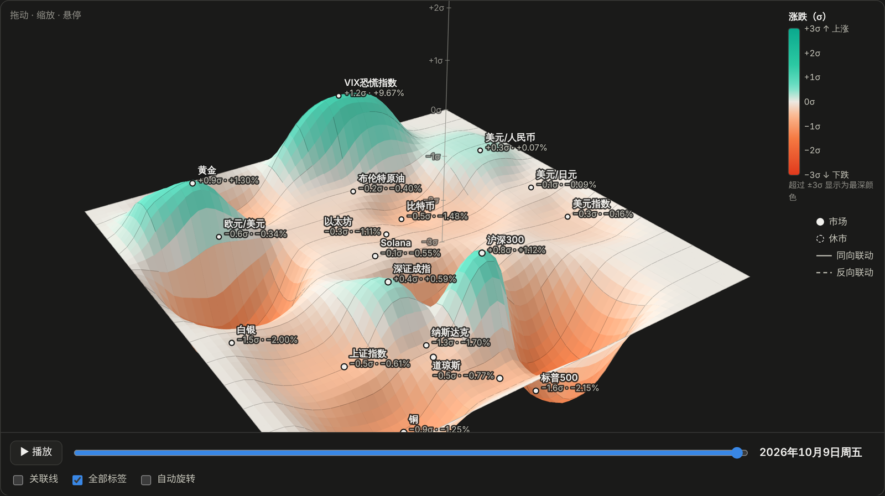

<div align="center">

# 市场脉搏 Market Pulse

**用一张可交互的 3D 地形图，看清今天全球市场怎么走、资金流向了哪里。**

[English](README.md) · **中文**

[](https://github.com/HuangCixin/market-pulse/actions/workflows/ci.yml)
[](LICENSE)


[**▶ 在线页面**](https://HuangCixin.github.io/market-pulse/)（真实数据，工作日每 30 分钟更新，加密货币实时）· [演示](https://HuangCixin.github.io/market-pulse/demo.html)（模拟数据）



</div>

Market Pulse 每天下载 **21 个市场**的价格，覆盖大宗商品、美股、中国股市、外汇、利率、波动率和加密货币，
并生成一个独立的网页，让你一眼看到：

- **谁在涨跌，以及涨跌有多异常。** 所有涨跌都用 σ 衡量（即本次涨跌相对于该市场正常日波动的倍数），
  因此外汇 0.3% 的波动和比特币 4% 的波动可以直接比较。
- **资金流向了哪里。** 市场按资产类别分成彩色区域（金属、外汇、中国股市、能源、美股与美债、加密货币），整片区域上升或下沉，就代表资金在不同资产之间轮动。
- **市场之间如何联动。** 相关系数、近期发生变化的关系，以及美股对上海和香港市场的次日传导效应。

网页可离线打开，没有任何外部依赖，并可一键切换 **English / 中文**。联网时，比特币、以太坊和 Solana 的价格还会通过交易所公开行情实时更新。

## 覆盖的市场

| 板块 | 市场 |
|---|---|
| 大宗商品 | 黄金、白银、WTI 原油、布伦特原油、铜 |
| 美股 | 标普 500、纳斯达克、道琼斯 |
| 中国股市 | 上证指数、沪深 300、深证成指、恒生指数 |
| 外汇 | 美元指数、欧元/美元、美元/人民币、美元/日元 |
| 利率与波动率 | 美国 10 年期国债收益率、VIX 恐慌指数 |
| 加密货币 | 比特币、以太坊、Solana |

可在 [`config.yaml`](config.yaml) 中添加或删除市场，支持任何 Yahoo Finance 代码。

## 网页内容

| 模块 | 内容 |
|---|---|
| **市场地形图** | 3D 曲面，高度和颜色都表示各市场的 σ 涨跌（青绿 = 上涨，橙红 = 下跌），附颜色条。拖动旋转，滚轮缩放，悬停查看详情，点击 **播放** 回放最近两个月。 |
| **资金流向** | 每个板块一张卡片，用双向条形图从强到弱排序。 |
| **走势** | 各板块的折线图，可选 1 个月 / 3 个月 / 6 个月 / 1 年。 |
| **市场联动** | 关系变化（60 天与 250 天相关系数对比）、美股 → 中国股市次日表、关键市场对的滚动相关系数，以及完整相关性矩阵。 |
| **全部市场** | 最新价及 1 日 / 1 周 / 1 月 / 3 月 / 年初至今 / 1 年涨跌幅。 |

顶部控件：**周期**（日 / 周 / 月）、**配色**（绿涨红跌，或中国习惯的红涨绿跌）、**主题**（浅色 / 深色）、
**语言**（English / 中文）。

<p align="center">
  
</p>

## 快速开始

需要 Python 3.10 及以上版本。

```bash
git clone https://github.com/HuangCixin/market-pulse.git
cd market-pulse
python -m venv .venv
source .venv/bin/activate          # Windows：.venv\Scripts\activate
pip install -r requirements.txt

python run_daily.py --demo --open  # 用模拟数据试用（无需联网）
python run_daily.py --open         # 真实数据：下载今天的价格并打开网页
```

| 命令 | 作用 |
|---|---|
| `python run_daily.py` | 下载价格并生成今天的网页 |
| `python run_daily.py --open` | 同上，并在浏览器中打开 |
| `python run_daily.py --demo` | 使用模拟数据，适合测试或离线使用 |
| `python run_daily.py --cache` | 使用上次下载的数据重新生成，不再联网 |

每次运行会输出到 `reports/<日期>/`：

```
report.html       交互网页（单个文件，可在任何地方打开或分享）
summary.json      要点（英文 + 中文）、市场状态、σ 涨跌、表现、相关性变化
performance.csv   表现数据表
```

**何时运行：** 美股收盘之后（巴黎时间 22:00，北京时间 04:00），此时所有板块都有完整的一天数据。

### 每天自动运行

**在 GitHub 上（已配置好）：** [`Daily update`](.github/workflows/pages.yml) 工作流用真实数据重新生成页面并发布到 GitHub Pages：

- 工作日 UTC 00:07–21:37 每 30 分钟一次（从亚洲开盘到美股收盘），生成盘中页面；
- 工作日 UTC 22:37，美股收盘后，生成当天的收盘页面；
- 周末每 3 小时一次，这时只有加密货币在交易。

还在交易的市场在页面上标为**盘中**，没走完的这一天不计入相关性（见[盘中更新](docs/METHODOLOGY.zh-CN.md#8-盘中更新与实时价格)）。
加密货币价格还会在浏览器里实时更新。如果某次下载失败，之前的页面会继续保留。也可以在
**Actions → Daily update → Run workflow** 手动运行。公开仓库连续 60 天没有活动，GitHub 会暂停定时任务，
所以 [`Keep schedules alive`](.github/workflows/keepalive.yml) 每月检查一次：仓库 30 天没有提交时，自动做一次空提交。

**在你自己的电脑上：**

macOS / Linux（`crontab -e`，工作日 23:00）：

```cron
0 23 * * 1-5 cd /path/to/market-pulse && .venv/bin/python run_daily.py >> logs.txt 2>&1
```

Windows：在“任务计划程序”中新建每日任务，在本文件夹中运行 `.venv\Scripts\python.exe run_daily.py`。

### 配合 Claude Code 使用

仓库中的 [`CLAUDE.md`](CLAUDE.md) 说明了项目结构和方法规则。在 [Claude Code](https://claude.com/claude-code)
中打开本文件夹，可以直接说“运行今天的报告并解释发生了什么”，或让它添加新市场、新图表。

## 工作原理

```
config.yaml ──► fetch.py ──► analyze.py ──► report.py ──► reports/<日期>/report.html
 （市场列表）  （yfinance，   （涨跌、σ、     （要点、       （template.html + 数据，
               本地缓存）     相关性、3D布局） JSON、CSV）     无外部依赖）
```

核心思路（详见 [docs/METHODOLOGY.zh-CN.md](docs/METHODOLOGY.zh-CN.md)）：

- **用 σ 而不是 %。** 每次涨跌除以该市场此前 60 天的日波动率，并按周期长度换算。
- **比较涨跌，而不是价格。** 价格类资产用对数收益率，收益率类资产用百分点的日变化。
- **尊重交易日历。** 节假日不会被填成“零涨跌”。计算相关性时所有市场都只取工作日，
  因此加密货币周一的涨跌与股票一样覆盖“周五 → 周一”。
- **考虑时区。** 亚洲市场在纽约开盘前就已收盘，所以美股对中国股市的影响按滞后一天计算。
- **没走完的一天只显示，不计算。** 交易时段内，市场当天的日线还在变化。它会显示在页面上并标为“盘中”，
  但不计入相关性和美股 → 中国股市的表格。
- **按资产类别分区。** 市场固定在 `config.yaml` 定义的彩色分区里，每个市场每天都在同一个位置。

> **关于地形图：** 圆点才是数据。圆点之间的曲面是为了呈现地形效果而做的平滑过渡，
> 它准确经过每个市场的真实数值，并在市场之间逐渐回到零。

## 项目结构

```
market-pulse/
├── run_daily.py            命令行入口
├── config.yaml             市场、板块、时间窗口、关键市场对
├── market/
│   ├── fetch.py            下载与缓存、模拟数据
│   ├── analyze.py          全部计算（返回可转为 JSON 的字典）
│   ├── report.py           中英文要点、网页与汇总文件
│   └── template.html       交互网页（原生 JS、canvas、SVG）
├── tests/                  pytest 测试
├── docs/                   方法说明（中英文）与截图
└── .github/workflows/      持续集成与在线演示部署
```

## 开发

```bash
pip install -r requirements-dev.txt
pytest                             # 运行测试
python run_daily.py --demo --open  # 修改 template.html 后检查网页
```

贡献指南见 [CONTRIBUTING.md](CONTRIBUTING.md)。

## 局限性

- **数据来源：** 价格来自 Yahoo Finance，通过非官方的 `yfinance` 库获取，存在延迟、偶尔缺失，
  仅供个人使用。本仓库只包含代码，不包含任何市场数据。
- **“资金流向”是根据价格推断的**，并非真实的资金流数据。
- **交易时间是近似的。** 交易时段写在 `config.yaml` 里，没有各交易所的节假日表，所以节假日会显示
  “暂无今日数据”而不是“休市”。定时任务有时会晚几分钟开始。
- **加密货币实时价格**来自 Coinbase 公开行情（Kraken 备用）。看网页的人的浏览器会直接连接这些交易所；
  价格旁边的按钮可以暂停。

## 免责声明

仅供研究和学习使用，不构成任何投资建议。

## 许可证

[MIT](LICENSE)
